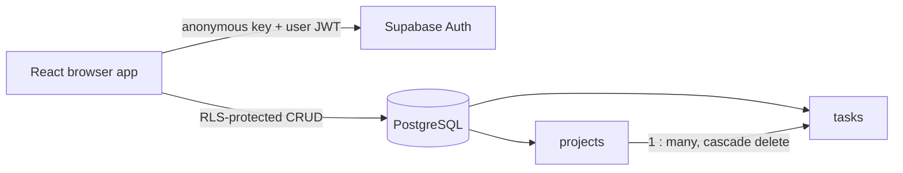

# Architecture

## Implemented system

FlowForge is a client-rendered React application backed directly by Supabase Auth and PostgreSQL. This removes the need for a duplicate application server in the MVP while keeping authorization at the database boundary.

## Entities

`projects` holds a user-owned name, description, lifecycle status, and optional target date. `tasks` belongs to one project and carries title, optional description/due date, status, and priority. Both have UUID IDs and automatic timestamps.

## Auth and authorization

Email/password authentication is implemented through Supabase Auth. On every protected table, RLS is enabled. Policies authorize reads and mutations only when `owner_id = auth.uid()`. Task policies additionally verify the parent project is owned by the same user. A database trigger rejects cross-project task writes and derives task ownership from the authenticated session.

## Boundaries and trade-offs

The anonymous/publishable Supabase key is intentionally browser-visible; the service-role key is never used. The UI detects missing configuration and stops at an honest setup screen. The trade-off is that no server-only features or AI operations are in scope. A future server/Edge Function would be the correct place for privileged AI calls and integrations.

## Deployment configuration

The browser client prefers `VITE_SUPABASE_URL` and `VITE_SUPABASE_ANON_KEY`. For the Vercel/Supabase integration it also accepts `NEXT_PUBLIC_SUPABASE_URL`, with `NEXT_PUBLIC_SUPABASE_PUBLISHABLE_KEY` preferred over `NEXT_PUBLIC_SUPABASE_ANON_KEY` as key fallbacks. Vite is configured to expose both `VITE_` and `NEXT_PUBLIC_` variables to the client bundle, so only public URL and anon/publishable keys may use these names. Never expose a secret or service-role key.
